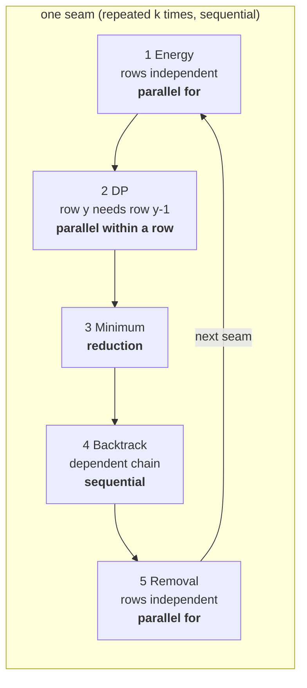
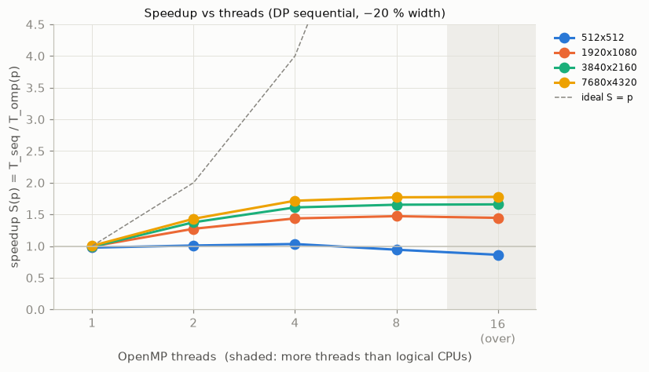
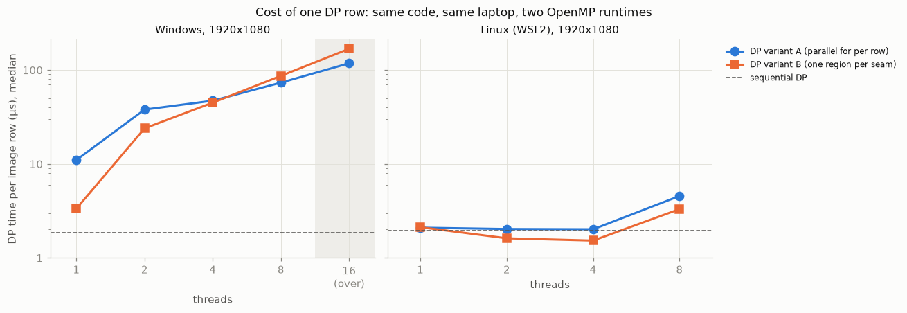
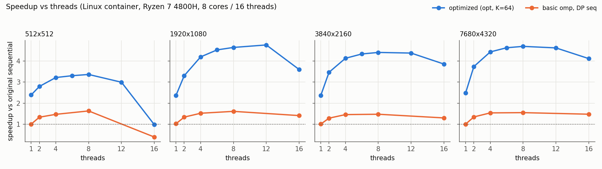
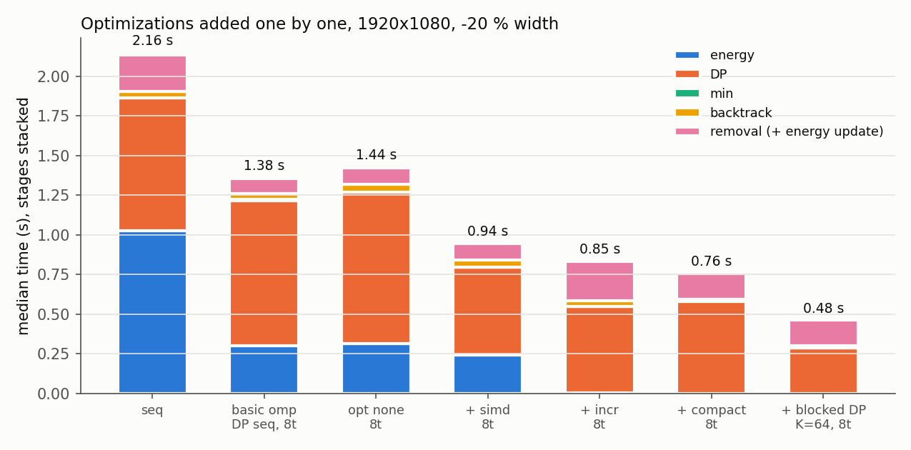
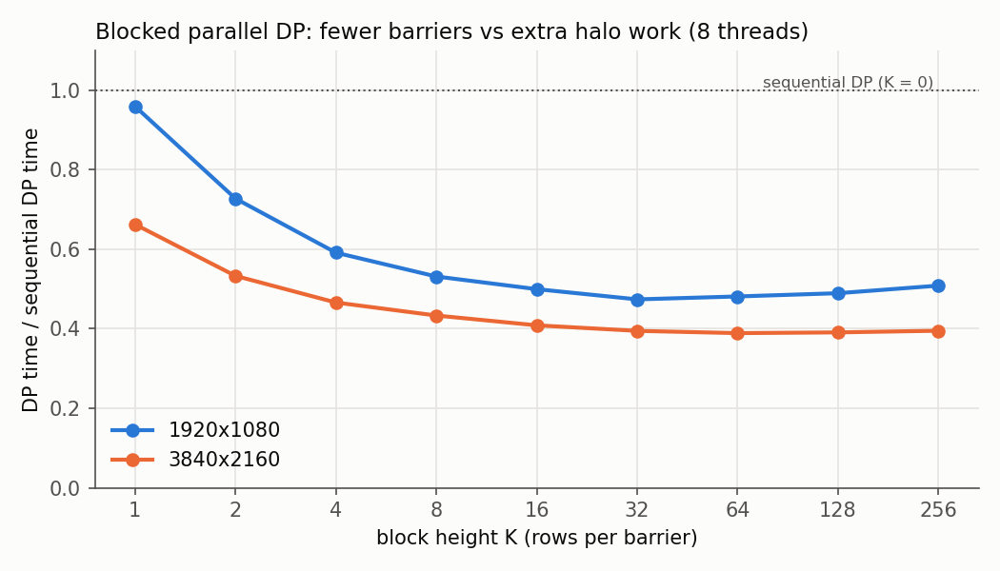

# Parallel Implementation of Seam Carving for Content-Aware Image Resizing using OpenMP

**Final Project Report – Parallel Computing**

Repository: `MyleCutie45/TTSS` · Language: C++17 · Parallel framework: OpenMP · Build: CMake

---

## Abstract

Seam carving (Avidan and Shamir, 2007) shrinks an image by repeatedly removing a connected path of
low-energy pixels, so that salient content keeps its shape. Each removal requires an energy map, a
dynamic-programming (DP) pass over the whole image, a backtracking step and a pixel shift, and the
removals form a strictly sequential chain. This report describes three implementations that produce
bit-identical results: a sequential baseline, a direct OpenMP parallelization of each stage, and an
optimized OpenMP version. On an Intel Core i7-1065G7 under Windows, the direct parallelization is slower
than the sequential program whenever the DP is parallel, because every image row requires a barrier that
costs 22–167 µs in the Windows build of the OpenMP runtime; with the DP kept sequential it reaches
1.40–1.79×. The optimized version removes redundant work (incremental energy update, vectorizable
kernels), reduces memory traffic (16-bit energy, 1-byte backtracking directions) and replaces the per-row
barrier by one barrier per block of 64 rows with redundant "halo" computation. On an AMD Ryzen 7 4800H
(Linux container) it is 4.4–4.8× faster than the sequential program with 8 threads, compared with
1.5–1.6× for the direct parallelization on the same machine. The remaining limit is the memory bandwidth
of the seam-removal stage.

---

## 1. Introduction

Content-aware image resizing changes the aspect ratio of an image without uniformly scaling or cropping
it. Seam carving achieves this by deleting, one at a time, the 8-connected path of pixels ("seam") whose
summed gradient energy is minimal. The method is simple, but expensive: removing *k* seams from a
*W × H* image costs Θ(k · W · H) operations, and the *k* removals cannot be performed independently,
because each seam depends on the image left by the previous one.

The goal of this project is to study how far this algorithm can be accelerated on a shared-memory
multicore processor with OpenMP, and *why* it does or does not scale. The project was organised in
seven milestones: research (M0), sequential implementation (M1), OpenMP implementation (M2),
correctness testing (M3), benchmarking (M4), optimization (M5) and this report (M6).

Contributions of the project:

1. A sequential reference implementation with explicitly specified integer arithmetic and tie-breaking
   rules, so that every parallel variant can be compared bit for bit (Section 5).
2. A stage-by-stage OpenMP parallelization with switchable stages and two DP variants (Section 7).
3. A measurement-based explanation of why the parallel DP fails on Windows (synchronization cost) and
   why it scales poorly even where synchronization is cheap (memory traffic) (Sections 10–12).
4. An optimized version whose every optimization can be switched off and was measured in isolation
   (Section 13).

**Original research vs. our work.** The seam definition, the energy function *e₁*, the DP recurrence
and the use of transposition for horizontal seams come from Avidan and Shamir (2007). Every
implementation decision (integer energy without normalisation, clamped borders, tie rules, the
parallelization, all optimizations) and every measurement in this report is our own work; Table 1
lists them.

| Topic | From the original paper | Our decision |
| ----- | ----------------------- | ------------ |
| Energy | *e₁ = \|∂I/∂x\| + \|∂I/∂y\|* | central differences without division by 2, on the gray image, clamped at borders, 32-bit integers (16-bit in M5) |
| Seam | 8-connected, one pixel per row | same |
| Optimal seam | DP over cumulative energy *M* | same recurrence; ties: smallest column wins (endpoint and backtracking) |
| Repeated removal | recompute after each seam | M1/M2: full recomputation; M5: provably equivalent local update |
| Height reduction | transpose | transpose after the width has been reduced |
| Optimal order of vertical/horizontal seams, enlarging, masks, multi-size images | described in the paper | out of scope |
| Parallelization, synchronization, optimization | not addressed | Sections 6–13 |

*Table 1 – What comes from the original paper and what was decided in this project.*

---

## 2. Problem Statement

Given a color image *I* of size *W × H* and a target size *W′ × H′* with *W′ ≤ W*, *H′ ≤ H*, produce
the image obtained by removing *W − W′* vertical seams and then *H − H′* horizontal seams, each time the
seam of minimal energy, **exactly as the sequential algorithm does**. The parallel program must:

- produce an output that is bit-identical to the sequential output for every image, target size,
  thread count and schedule (determinism);
- be faster than the sequential program on a multicore CPU, and the speedup must be explained by
  measurements;
- keep the sequential program as an unchanged correctness baseline.

The difficulty is structural. Of the five stages executed for every seam (Section 4), two are
embarrassingly parallel (energy, removal), one is a reduction (minimum), one is an inherently sequential
chain (backtracking), and the most expensive one, the DP, has a row-to-row dependency that allows
parallelism only *within* a row. Moreover, all stages are executed thousands of times on the same data
with little arithmetic per pixel, so synchronization and memory traffic, not computation, decide the
performance.

---

## 3. Background and Related Work

**Seam carving.** Avidan and Shamir (2007) introduced seams as monotone, 8-connected paths and showed
that the optimal seam under an additive energy can be found by dynamic programming in *O(W · H)*. They
compared several energy functions (gradient magnitude *e₁*, entropy, histogram of gradients) and
proposed an optimal ordering of vertical and horizontal removals, seam insertion for enlarging, and
object removal. Rubinstein, Shamir and Avidan (2008) introduced *forward energy*, which measures the
energy inserted by a removal, and graph-cut formulations for video. This project implements the basic
backward-energy (*e₁*) algorithm, which is the common baseline.

**OpenMP.** OpenMP (OpenMP ARB, 2021) is a directive-based shared-memory programming model. A
`parallel` region creates a team of threads; work-sharing constructs (`for`) divide loop iterations
among them according to a *schedule* (`static`, `dynamic`, `guided`); an implicit *barrier* at the end of
a work-sharing loop ensures that all iterations are finished before any thread continues. The `simd`
construct asks the compiler to vectorize a loop, and the `if` clause executes a region serially when a
condition is false (Chapman, Jost and van der Pas, 2008).

**Performance models.** Amdahl's law (Amdahl, 1967) bounds the speedup of a program with a serial
fraction *f* by *1 / (f + (1−f)/p)*. For memory-intensive kernels, the attainable performance is bounded
by the product of arithmetic intensity and memory bandwidth (the *roofline* model, Williams, Waterman and
Patterson, 2009); we measure the bandwidth with a STREAM-like kernel (McCalpin, 1995).

**Wavefront and overlapped tiling.** The DP is a stencil-like recurrence in which row *y* depends on
three cells of row *y − 1*. The standard way to reduce synchronization in such iterative stencils is to
let each thread compute a slightly larger region than it owns ("ghost zones" or overlapped tiles), trading
redundant computation for fewer barriers (Meng and Skadron, 2009). Our blocked DP (Section 13.3) applies
this idea to the seam-carving DP.

---

## 4. Original Seam Carving Algorithm

Let *I* be the gray image and *W* its current width.

**Energy** (Avidan and Shamir's *e₁*):

$$
e(x,y) = \left|\frac{\partial I}{\partial x}\right| + \left|\frac{\partial I}{\partial y}\right|
$$

**Vertical seam.** A seam is a set *s = {(s(y), y) : y = 0 … H−1}* with *|s(y) − s(y−1)| ≤ 1*; its cost
is *E(s) = Σ_y e(s(y), y)*, and the optimal seam is *s\* = argmin_s E(s)*.

**Dynamic programming.** The minimal cost of a seam ending at *(x, y)* is

$$
M(x,0) = e(x,0), \qquad
M(x,y) = e(x,y) + \min\bigl(M(x-1,y-1),\; M(x,y-1),\; M(x+1,y-1)\bigr),
$$

where neighbours outside the image are ignored. The minimum of the last row is the cost of *s\**, and the
seam is recovered by backtracking from that cell to row 0, always moving to the smallest upper
neighbour.

**Removal and repetition.** The seam pixel is deleted in each row and the pixels to its right are shifted
left, giving a *(W − 1) × H* image. Energy and *M* are recomputed for the next seam. Horizontal seams are
handled by transposing the image.

**Complexity.** One seam costs *Θ(W · H)*; removing *k* seams costs

$$
\sum_{i=0}^{k-1} (W-i)\,H = k\,H\left(W - \tfrac{k-1}{2}\right) = \Theta(k\,W\,H).
$$

---

## 5. Sequential Implementation

The sequential program (`src/seam_seq.cpp`, namespace `seq`, compiled **without** OpenMP) executes, for
every seam, five stages:

```text
function CARVE(image, targetWidth, targetHeight):
    gray  <- toGray(image)                          // once (OpenCV cvtColor)
    width <- image.cols
    while width > targetWidth:                      // k iterations, strictly sequential
        e   <- COMPUTE_ENERGY(gray, width)          // stage 1   Θ(W·H)
        M   <- COMPUTE_CUMULATIVE(e, width)         // stage 2   Θ(W·H), rows dependent
        end <- FIND_MIN_ENDPOINT(M[H-1], width)     // stage 3   Θ(W)
        s   <- BACKTRACK(M, end)                    // stage 4   Θ(H), chain of dependent steps
        REMOVE_SEAM(image, gray, s, width)          // stage 5   Θ(W·H) memory moves
        width <- width - 1
    if targetHeight < H: transpose, repeat for rows, transpose back
    return image[:, 0 .. targetWidth-1]
```

Implementation decisions (all documented in `docs/algorithm.md`, decisions D1–D7):

- **Integer arithmetic.** *e(x,y) = |I(x+1,y) − I(x−1,y)| + |I(x,y+1) − I(x,y−1)|* with indices clamped to
  the image, without division by 2; the maximum is 510. *M* fits easily into 32-bit integers
  (510 · 4320 ≈ 2.2 · 10⁶). Integer arithmetic makes the results independent of the evaluation order,
  which is the precondition for exact comparison of parallel results.
- **Deterministic ties.** The smallest column wins at the endpoint and in backtracking (candidates in the
  order *x−1, x, x+1*, strict `<`).
- **Current width.** All stages operate on columns *[0, width)* of matrices allocated once at the original
  size; the result is cropped at the end. No reallocation happens inside the seam loop.
- **Gray image updated, not recomputed.** The gray image is shifted together with the color image.

---

## 6. Parallelization Strategy

The outer seam loop cannot be parallelized: seam *i + 1* is defined on the image produced by seam *i*.
All parallelism is therefore *inside* one seam iteration (Figure 1).



*Figure 1 – Stages of one seam and the parallelism available in each.*

| Stage | Dependency | Strategy (M2) | Synchronization per seam |
| ----- | ---------- | ------------- | ------------------------ |
| Energy | none between pixels | `parallel for` over rows | 1 region + 1 barrier |
| DP | row *y* needs row *y − 1* | `for` over columns of each row | **1 barrier per row** (*H* per seam) |
| Minimum | reduction over the last row | per-thread minimum, sequential combine | 1 region |
| Backtrack | *s(y−1)* depends on *s(y)* | sequential | – |
| Removal | rows independent | `parallel for` over rows | 1 region + 1 barrier |

The DP is the critical stage: for a 1920 × 1080 image and 384 seams it requires
414 336 synchronizations ((1080 − 1) rows × 384 seams), each protecting only about 2 µs of work (Section 10.4).

---

## 7. OpenMP Implementation

The OpenMP version (`src/seam_omp.cpp`, namespace `omp_impl`) mirrors the sequential code stage by
stage; a `ParallelConfig` selects which stages run in parallel (`--stages energy,dp,min,removal`) and
which DP variant is used. All loops use `schedule(runtime)`; the program sets `static` unless
`OMP_SCHEDULE` is defined.

**Energy and removal** – rows are independent; every iteration writes only row *y*:

```cpp
#pragma omp parallel for schedule(runtime)
for (int y = 0; y < height; ++y)
    removeRow(image, gray, width, seam[y], y);   // writes only row y of image and gray
```

**DP, variant A** – a new parallel loop for every row; its implicit barrier guarantees that row *y* is
complete before row *y + 1* is started:

```cpp
for (int y = 1; y < height; ++y) {                // sequential: dependency between rows
    const int* prev = M.ptr<int>(y - 1);
    #pragma omp parallel for schedule(runtime)
    for (int x = 0; x < width; ++x)
        m[x] = dpCell(prev, e, width, x);         // reads row y-1, writes only cell x of row y
}
```

**DP, variant B** (`--persistent-dp`) – one parallel region per seam; every thread runs the row loop and
the work-sharing `omp for` (without `nowait`) provides the barrier per row.

**Minimum** – each thread computes the minimum of its part with the same tie rule and stores it in its
own slot; the combination over at most *p* slots is sequential:

```cpp
#pragma omp parallel
{
    int bestValue = INT_MAX, bestCol = -1;                 // private
    #pragma omp for schedule(runtime) nowait
    for (int x = 0; x < width; ++x)
        if (better(last[x], x, bestValue, bestCol)) { bestValue = last[x]; bestCol = x; }
    local[omp_get_thread_num()] = {bestValue, bestCol};    // own slot only
}
```

**Backtracking** is sequential (*Θ(H)*, a chain of dependent steps).

---

## 8. Synchronization and Data Dependencies

| Location | Shared data | Hazard without synchronization | Protection |
| -------- | ----------- | ------------------------------ | ---------- |
| DP row *y* | row *y − 1* of *M* | a thread reads a cell of row *y − 1* that another thread has not yet written (read-after-write race) | barrier after every row (A: end of region, B: implicit barrier of `omp for`) |
| Minimum | per-thread slots | two threads writing the same slot (lost update) | one slot per thread; combination after the region's barrier |
| Energy, removal | image rows | none: each iteration writes only its own row and reads only immutable data | – |
| Next stage | all outputs of a stage | next stage reads unfinished data | implicit barrier at the end of each region |
| M5 removal + local energy update | gray rows *y ± 1* | update reads rows still being shifted by another thread | implicit barrier between the two `omp for` loops |
| M5 blocked DP | shared boundary row | reading a boundary row being written | one barrier per block; two boundary rows used alternately |

Each hazard was demonstrated by a *positive control*: the M3 mutation test removes the DP barrier
(`nowait` in variant B) and the test suite detects it (75 failed checks), and ThreadSanitizer with the
Archer OpenMP tool reports 83 races in exactly that line, while the original code produces no report
(`docs/testing_report.md`). The same was done for the M5 barriers (Section 13.6).

Determinism follows from three properties: (i) all arithmetic is on integers, so `min` and `+` give the
same result in any order; (ii) the only reduction (minimum) uses a total order (value, then column);
(iii) no thread writes data that another thread reads in the same phase.

---

## 9. Experimental Setup

Two platforms were used, because the M5 work was carried out on a different laptop than M3/M4.
**Results of different platforms are never compared directly**; every speedup is relative to a
sequential run on the same platform in the same session.

| | Platform A (M3, M4) | Platform B (M5) |
| - | ------------------- | ---------------- |
| CPU | Intel Core i7-1065G7, 4 cores / 8 threads, L3 8 MB | AMD Ryzen 7 4800H, 8 cores / 16 threads, L3 2 × 4 MB |
| OS | Windows 11 (supplementary run: WSL2 Ubuntu 26.04) | Docker container, Ubuntu 24.04 on the WSL2 kernel |
| Compiler / OpenMP | GCC 16.2.0, libgomp (WSL: GCC 15.2.0) | GCC 13.3.0, libgomp |
| Flags | `-O2 -DNDEBUG -std=c++17 -Wall -Wextra -fopenmp` | same |
| OpenCV | 5.0.0 (WSL: 4.10.0) | 4.6.0 |
| Memory bandwidth (STREAM-like, 8 threads) | read 45.9, copy 24.3 GB/s | read 33.6–34.8, copy 19.1–19.6 GB/s |

Platform B uses a container because Windows Smart App Control on that laptop blocks locally compiled
executables.

**Methodology** (`docs/benchmark_plan.md`, `scripts/run_bench.py`):

- Images: one photograph (`person_desert`) at 512 × 512, 1920 × 1080, 3840 × 2160, 7680 × 4320, plus five
  other scenes at 1920 × 1080 (`bench_images/`). Reduction 10–30 % of the width (default 20 %;
  7680 × 4320 in M5: 10 %).
- Each configuration: one warm-up run (discarded) and 5 measured runs (M5, 7680 × 4320: 3); runs of
  different configurations interleaved in random order. Reported value: median.
- Time: the `carve()` call only, split into the five stages; image I/O is excluded.
- Every output image is hashed (SHA-256) and compared with the sequential output.
- Thread counts 1, 2, 4, 8 (and 6, 12) and 16; 16 exceeds the physical cores on both machines.

---

## 10. Performance Evaluation

All numbers in Sections 10–13 are measured unless marked *calculation* or *hypothesis*. Raw data:
`results/*.csv`; generated tables: `results/summary.md` (M4) and `results/m5_summary.md` (M5).

### 10.1 Correctness

| Test | Result |
| ---- | ------ |
| `test_seq` (hand-computed 4 × 4 example, tie rule, brute-force optimality, edge cases) | 65 checks, 0 failed |
| `test_equivalence` (OpenMP vs. sequential, every stage of every seam, thread counts, schedules) | 147 368 checks, 0 failed |
| `test_m3` (independent reference implementation, 1 × 1 … 3840 × 2160, 1–20 threads) | 71 580 checks, 0 failed |
| `test_opt` (M5 kernels and whole carve vs. sequential) | 18 636 checks, 0 failed |
| Mutation testing (M3: 8 mutants, M5: 10 mutants) | all 18 mutants detected |
| AddressSanitizer + UBSan (`test_seq`, `test_m3`, `test_equivalence`, `test_opt`) | no report |
| ThreadSanitizer + Archer (`test_m3`; `test_opt` see 13.6) | no report on the original code; the race of the barrier mutant is reported |
| Benchmark outputs identical to sequential output | M4: 1 191 / 1 191, M5: 714 / 714 |

### 10.2 Where the sequential time goes

Platform A, 1920 × 1080, −20 % (384 seams), sequential median 1.964 s: energy 52 %, DP 39 %, removal
7 %, backtracking 1.4 %, minimum 0.07 %. Energy and DP account for 91 % of the time; the stages that
cannot be parallelized well (minimum, backtracking) are below 2 %.

### 10.3 Direct parallelization (M2), Platform A



*Figure 2 – M2 with the DP kept sequential, Platform A (Windows).*

| Image (seams) | seq (s) | all four stages parallel, 4 threads | DP sequential, 4 threads | DP sequential, 8 threads |
| ------------- | ------: | ----------------------------------: | -----------------------: | -----------------------: |
| 512 × 512 (102) | 0.062 / 0.064 | 2.478 s (0.03×) | 0.062 s (1.03×) | 0.068 s (0.94×) |
| 1920 × 1080 (384) | 2.002 / 1.934 | 20.317 s (0.10×) | 1.347 s (1.44×) | 1.315 s (1.47×) |
| 3840 × 2160 (768) | 16.220 / 16.078 | 83.660 s (0.19×) | 9.987 s (1.61×) | 9.731 s (1.65×) |
| 7680 × 4320 (768 / 1536) | 70.942 / 132.445 | 184.084 s (0.39×) | 77.220 s (1.72×) | 74.854 s (1.77×) |

*Table 2 – M2 on Platform A (median `t_total`; the two sequential values belong to the two experiments,
which differ in the reduction for 7680 × 4320).*

With the DP in parallel the program is slower than the sequential program in every configuration (speedup
0.01–0.68), and **more threads make it slower**. With the DP kept sequential it reaches 1.40–1.79× for
1920 × 1080 and larger.

### 10.4 Why the parallel DP fails on Windows



*Figure 3 – DP time per image row, Platform A.*

One DP row of an average width of 1728 pixels contains 1.84 µs of work (≈ 1.06 ns per cell). On Windows,
the per-row synchronization adds 9.2 µs even with one thread (entering and leaving a parallel region) and
22–167 µs with 2–16 threads. With 4 threads, 414 336 synchronizations × 45 µs ≈ 18.8 s (*calculation*)
explain the measured DP time of 19.6 s. A simple model,
*t_row(p) ≈ w·W/p + o(p)*, shows that the parallel DP pays off only if *w·W·(1 − 1/p) > o(p)*: on Windows
(*o(4)* ≈ 45 µs) for images wider than about 56 000 pixels, under Linux (*o(4)* ≈ 1.0–1.5 µs) for widths
above 1 200–1 800 pixels (*calculation*). The supplementary Linux run on the same laptop confirmed this:
the parallel DP became as fast as or faster than the sequential DP (up to 1.27× at 1920 × 1080, variant B),
and all four stages in parallel reached 1.36–1.71× with 4 threads. **The slowness is caused by the
OpenMP runtime on Windows, not by the algorithm.**

### 10.5 Optimized version (M5), Platform B

| image | seq (s) | M2 best (8 thr.) | M5, 1 thread | M5, 4 threads | M5, 8 threads | M5, 16 threads |
| ----- | ------: | ---------------: | -----------: | ------------: | ------------: | -------------: |
| 512 × 512, −20 % | 0.066 | 1.63× | 2.39× | 3.21× | **3.36×** | 0.98× |
| 1920 × 1080, −20 % | 2.213 | 1.61× | 2.37× | 4.19× | **4.64×** | 3.60× |
| 3840 × 2160, −20 % | 16.388 | 1.48× | 2.37× | 4.13× | **4.40×** | 3.85× |
| 7680 × 4320, −10 % | 66.038 | 1.55× | 2.49× | 4.43× | **4.69×** | 4.11× |

*Table 3 – Speedup over the sequential program on Platform B ("M2 best" = energy + minimum + removal
parallel, DP sequential). The maximum, 4.76×, was measured at 1920 × 1080 with 12 threads.*



*Figure 4 – Speedup over the sequential program, optimized version (blue) and best M2 configuration
(orange), Platform B.*

On the five other scenes (1920 × 1080, 8 threads) the speedup ranges from 4.18× to 6.33×; all outputs are
identical to the sequential outputs.

---

## 11. Speedup and Efficiency Analysis

Speedup *S(p) = T_seq / T(p)*; efficiency *E(p) = S(p) / p*.

**Decomposition of the M5 speedup.** The optimized version is 2.37–2.49× faster than the sequential
program *with one thread*, because it does less work (Section 13). From 1 to 8 threads it gains a further
1.9–2.0×. The total of 4.4–4.8× is the product of both. Measured against its own one-thread time, the
efficiency at 8 threads is therefore only ≈ 0.25; measured against the sequential program, *E(8)* =
0.42–0.59. Both views are reported because both are common, and they answer different questions: the
first measures parallel scalability, the second the benefit for the user.

**Amdahl's law for M2.** With the DP sequential, the serial fraction on Platform A at 1920 × 1080 is at
least the DP share, *f ≈ 0.39–0.40*. The bound *1/(f + (1 − f)/p)* gives 1.82× for *p = 4* and 2.11× for
*p = 8* (*calculation*); the measured 1.44× and 1.47× are below the bound because the parallel stages
themselves do not scale linearly (energy 3.3–3.6×, removal ≈ 1.1× at this size). As *p → ∞* the bound is
1/f ≈ 2.5×: **M2 can never exceed about 2.5× without parallelizing the DP.** M5 removes this limit by
making the DP parallel and cheap.

**Saturation.** In M5 most of the gain is reached with 4 threads; 8–12 threads add 5–15 %. Two stages
remain after the optimizations, the DP and the removal (Table 4), and both are memory-bound
(Section 12.2).

| 7680 × 4320 | 1 thread | 2 | 4 | 8 | 16 |
| ----------- | -------: | -: | -: | -: | -: |
| DP (s) | 16.54 | 10.00 | 7.27 | 5.93 | 7.28 |
| removal (s) | 9.67 | 7.34 | 7.34 | 7.91 | 8.41 |
| total (s) | 26.57 | 17.69 | 14.91 | 14.08 | 16.06 |

*Table 4 – Stage times of the optimized version at 7680 × 4320.*

**Size dependence.** Larger images give more work per synchronization, so the efficiency increases with
the image size (M4: 1.03 → 1.44 → 1.61 → 1.72 with 4 threads, DP sequential). For 512 × 512 the M5 version
still gains 3.36× with 8 threads under Linux, but collapses with 16 threads (0.98×, highly variable).

---

## 12. Bottlenecks and Limitations

### 12.1 Synchronization

Per-row barriers make a fine-grained wavefront DP impractical on platforms with expensive
synchronization (Section 10.4). Even under Linux, where a barrier costs about 1 µs, a 512 × 512 image has
only about 0.5 µs of DP work per row (*calculation*: 512 cells × ≈ 1 ns).

### 12.2 Memory bandwidth

Every stage performs only a few operations per byte. Platform B sustains 34–35 GB/s for reading, 12.7 GB/s
for writing and 19.1–19.6 GB/s for copying with 8 threads (`results/m5_membw.txt`). Two observations
follow:

- *DP.* With a full 32-bit *M* matrix, the DP touches ≈ 12 bytes per cell and its working set at
  1920 × 1080 (≈ 16.6 MB) exceeds the 8 MB L3 cache (*calculation*); the blocked parallel DP then gains
  almost nothing (0.547 → 0.512 s). After the compact-memory optimization the working set is ≈ 6.2 MB and
  the same parallel DP halves the time (0.580 → 0.287 s).
- *Removal.* At 7680 × 4320 with 8 threads, the seam removal moves an estimated 145 GB in 7.91 s ≈ 18 GB/s
  (*calculation*, seams assumed uniformly distributed), i.e. close to the measured copy bandwidth. More
  threads cannot speed it up, and it is now the largest stage.

### 12.3 Simultaneous multithreading

16 threads on 8 cores are slower than 8 threads in every configuration on Platform B, and highly
variable on small images (0.043–0.337 s for 512 × 512). Two hardware threads of a core share its caches
and load/store units, and every barrier waits for the slowest thread.

### 12.4 Inherently sequential parts

The seam loop, the backtracking and the minimum remain sequential. Their share is small (< 3 %), but it
grows as the parallel stages get faster.

### 12.5 Limitations of the study

- Two different machines and operating systems for M4 and M5; M5 was measured in a container on a
  virtualized Linux kernel (WSL2), not natively on Windows.
- One compiler family (GCC/libgomp) for all performance results; clang/libomp was used only for the
  ThreadSanitizer checks.
- Memory-traffic arguments are calculations; hardware performance counters were not available in the
  container.
- Only the basic *e₁* energy and seam removal are implemented (no forward energy, no enlarging, no
  optimal seam order).

---

## 13. Optimization

Every optimization of the M5 version (`src/seam_opt.cpp`, `--mode opt`) can be switched off and was
measured against the previous step (`docs/optimization_report.md`). Figure 5 shows the step chain.



*Figure 5 – Stage times when the optimizations are added one by one, 1920 × 1080, 8 threads, Platform B.*

| step (8 threads, 1920 × 1080) | total (s) | speedup vs. seq |
| ----------------------------- | --------: | --------------: |
| sequential | 2.160 | 1.00 |
| M2, DP sequential | 1.378 | 1.57 |
| M5, all optimizations off | 1.435 | 1.51 |
| + SIMD kernels (O2) | 0.944 | 2.29 |
| + incremental energy (O1) | 0.850 | 2.54 |
| + compact memory (O5) | 0.764 | 2.83 |
| + blocked DP, K = 64 (O3) | **0.479** | **4.51** |

*Table 5 – Step chain (median of 5 runs).*

### 13.1 O2 – Vectorizable kernels

Only the border columns need index clamping. Treating columns 0 and *W − 1* separately leaves a
branch-free interior loop that the compiler vectorizes under `#pragma omp simd`. One thread: energy 2.8×,
DP 1.7× faster.

### 13.2 O1 – Incremental energy

**Claim.** After removing seam pixel *s = s(y)* from row *y*, only the new columns *s − 1* and *s* of row *y*
can change their energy. *Argument.* The energy at new column *x* depends on columns *x ± 1* of row *y* and
column *x* of rows *y ± 1*, whose seam positions differ from *s* by at most one. For *x ≤ s − 2* all four
pixels lie left of every involved seam and are unchanged; for *x ≥ s + 1* all four pixels moved one
position left, so the energy equals the old energy at *x + 1*, which the shift moves along. The energy is
therefore computed once, shifted with the image, and two values per row are recomputed:

```cpp
#pragma omp parallel if(par)
{
    #pragma omp for schedule(runtime)
    for (int y = 0; y < height; ++y) removeRow(image, gray, energy, width, seam[y], y);
    // implicit barrier: all rows are shifted before rows y-1 and y+1 are read below
    #pragma omp for schedule(runtime)
    for (int y = 0; y < height; ++y)
        energyRowRange(gray, width - 1, *energy, y, max(0, s-1), min(width-1, s+1), false);
}
```

The claim is verified after every seam against a full recomputation (`tests/test_opt.cpp`). The energy
stage drops from 1.110 s to 0.007 s (one thread), while the removal doubles because it shifts the energy
map too.

### 13.3 O3 – Blocked DP with halo computation

Rows are processed in blocks of *K*. Thread *t* owns columns *[a, b)*. In local row *j = 0 … K − 1* of a
block it computes, in private buffers, the widened range

$$
\bigl[a-(K-1-j),\; b+(K-1-j)\bigr),
$$

which shrinks by one column per side per row and equals its own range in the last row. The first row of
the block reads the complete last row of the previous block, which is guaranteed by **one barrier per
block**. Every cell is computed with the same inputs as in the sequential DP, so *M* is identical.

```text
parallel region:
    [a, b) <- my columns
    for each block of rows y0 .. y0+K-1:
        prev <- shared last row of previous block, columns [a-K, b+K)
        for j in 0 .. K-1:
            lo <- a-(K-1-j);  hi <- b+(K-1-j)          // clipped to [0, W)
            cur[lo:hi] <- e[y0+j][lo:hi] + min3(prev)  // private buffer
            publish cur[a:b] (directions, last row)    // own columns only
            swap(prev, cur)
        barrier                                         // one per block
```

Barriers per seam fall from *H* to *H/K*; the redundant work is about *K − 1* cells per row and thread
(≈ 1 % for *K* = 64, 1920 columns, 8 threads; *calculation*). The DP time drops monotonically up to
*K* ≈ 16 and is flat between 16 and 256 (Figure 6); *K* = 64 is the default.



*Figure 6 – DP time relative to the sequential DP versus block height K, 8 threads, Platform B.*

### 13.4 O5 – Compact memory

The energy fits into 16 bits (maximum 510). Backtracking needs only the direction (−1, 0, +1) of the best
upper neighbour, which is stored in one byte per pixel; *M* is kept in two rolling rows, and the last
row is saved for the minimum search. The direction uses the sequential tie rule, so the seam is
unchanged: `seam[y-1] = seam[y] + dir[y][seam[y]]`. This reduces the DP working set from ≈ 16.6 MB to
≈ 6.2 MB at 1920 × 1080 and is what makes O3 effective (Section 12.2): with 8 threads, total time
0.845 → 0.479 s when O5 is added to O1 + O2 + O3.

### 13.5 Optimizations not adopted

- **Size threshold** (`if` clause below *N* pixels): no gain at ≤ 12 threads on Linux, because even
  512 × 512 benefits from 8 threads; kept as an option, default off.
- **Schedules** `static,1`, `dynamic,16`, `guided`: within the run-to-run noise (≤ 5 %); every row has the
  same cost, so there is no load imbalance to correct. `static` is kept.
- **Parallel minimum and backtracking**: M4 measured the parallel minimum 8–100× slower; backtracking is a
  dependent chain.

### 13.6 Verification of the optimized version

`tests/test_opt.cpp` compares every kernel (energy 32/16-bit, DP, directions for
*K* ∈ {0, 1, 2, 3, 4, 5, 8, 16, 31, 64, 1000}, incremental update) and the whole `carve` with the
sequential code for 1–16 threads: 18 636 checks, 0 failed, also under AddressSanitizer/UBSan. Ten mutants
(e.g. removed block barrier, halo one cell short, removed removal barrier, wrong tie rule, single shared
boundary row) are all detected. ThreadSanitizer with the Archer OpenMP tool (clang 18, LLVM libomp) reports **no data race** on the original code (`test_opt` full, 18 636 checks), and 290 data-race reports in `src/seam_opt.cpp` when the block barrier is removed (positive control, 612 failed checks).

---

## 14. Conclusion and Future Work

Seam carving offers parallelism only inside each seam, and its most expensive stage, the DP, needs a
synchronization per image row. A direct OpenMP parallelization therefore depends heavily on the cost of a
barrier: on Windows with GCC's libgomp it made the program up to 100× slower, while under Linux it gave a
modest gain. Keeping the DP sequential limits the speedup to about 2.5× by Amdahl's law; measured, 1.4–1.8×.

The optimized version shows that the decisive factors are **work avoidance** and **memory traffic**, not
the number of threads: one thread of the optimized code is already 2.4× faster than the original, the
blocked DP is useful only once the data of the DP fits into the cache, and the remaining bottleneck, the
seam removal, runs at close to the memory copy bandwidth. The final result is 4.4–4.8× over the
sequential program with 8 threads on an 8-core laptop, with outputs that are bit-identical to the
sequential program in every one of 1 905 benchmark runs and about 237 000 test checks (65 + 147 368 + 71 580 + 18 636 in the four full test programs).

Future work:

1. Avoid the physical pixel shift, e.g. by removing several non-overlapping seams per pass or by an
   index-based representation; this would change the algorithm and needs new correctness arguments.
2. Forward energy (Rubinstein et al., 2008) and seam insertion.
3. Native Windows measurements with a different OpenMP runtime (e.g. LLVM libomp) to separate runtime
   effects from hardware effects.
4. Hardware-counter measurements (cache misses, bandwidth) to confirm the memory-traffic calculations.
5. GPU implementation of the blocked DP, where the halo technique is commonly used.

---

## 15. References

1. S. Avidan and A. Shamir. *Seam Carving for Content-Aware Image Resizing.* ACM Transactions on Graphics
   26(3), Article 10 (Proceedings of SIGGRAPH 2007), 2007.
2. M. Rubinstein, A. Shamir and S. Avidan. *Improved Seam Carving for Video Retargeting.* ACM Transactions
   on Graphics 27(3), Article 16 (Proceedings of SIGGRAPH 2008), 2008.
3. OpenMP Architecture Review Board. *OpenMP Application Programming Interface, Version 5.2.* November 2021.
4. B. Chapman, G. Jost and R. van der Pas. *Using OpenMP: Portable Shared Memory Parallel Programming.*
   MIT Press, 2008.
5. G. M. Amdahl. *Validity of the Single Processor Approach to Achieving Large Scale Computing
   Capabilities.* AFIPS Spring Joint Computer Conference, pp. 483–485, 1967.
6. J. D. McCalpin. *Memory Bandwidth and Machine Balance in Current High Performance Computers.* IEEE
   Computer Society Technical Committee on Computer Architecture (TCCA) Newsletter, December 1995.
7. S. Williams, A. Waterman and D. Patterson. *Roofline: An Insightful Visual Performance Model for
   Multicore Architectures.* Communications of the ACM 52(4), pp. 65–76, 2009.
8. J. Meng and K. Skadron. *Performance Modeling and Automatic Ghost Zone Optimization for Iterative
   Stencil Loops on GPUs.* Proceedings of the 23rd International Conference on Supercomputing (ICS),
   2009.

**Project documents** (detailed evidence for every claim above): `docs/algorithm.md`,
`docs/parallelization_strategy.md`, `docs/architecture.md`, `docs/testing_report.md` (M3),
`docs/benchmark_report.md` (M4), `docs/optimization_report.md` (M5), `WORKLOG.md`.
