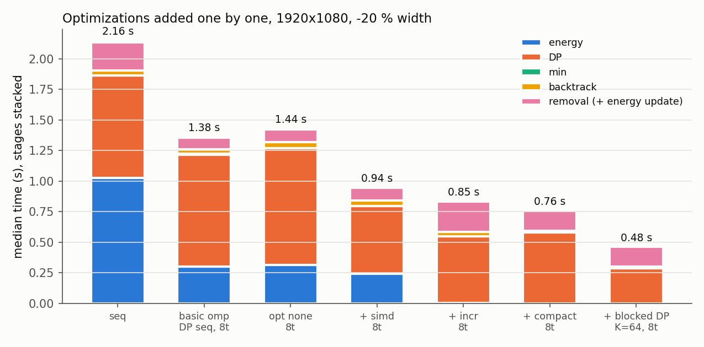
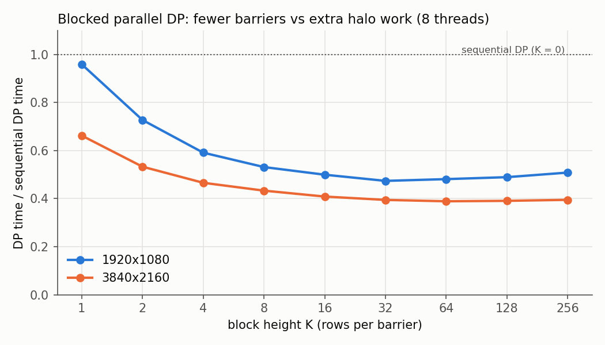
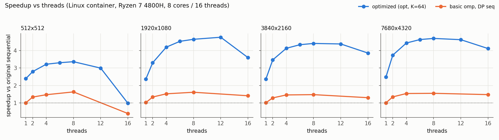

# Optimization Report (M5 – Performance Optimization)

**Milestone:** M5
**Status:** Final. Official benchmark run on 2026-11-20, 11:04–12:18 (UTC, 74 min), 714 runs, every run
exit code 0 and output image identical to the sequential output.

Every number in this report is measured unless it is marked *calculation*, *estimate* or *hypothesis*.
Sources: raw data `results/m5_*.csv` (one row per run), metadata `results/m5_*.meta.json`, tables
generated by `scripts/analyze_m5.py` in `results/m5_summary.md`, memory bandwidth reference
`results/m5_membw.txt`, plots `docs/figures/m5_*.png`.

---

## Summary

| Question | Answer (measured) |
| -------- | ----------------- |
| How fast is the optimized version? | **4.4–4.8× faster than the original sequential program** with 8 threads for 1920×1080 to 7680×4320 (best 4.76× at 1920×1080, 12 threads). The basic OpenMP version (M2) reaches 1.5–1.6× on the same machine. |
| Which optimization gives most? | Two independent groups. **Sequential work removed** (SIMD kernels, incremental energy, compact memory): 2.37× already with **one** thread. **Parallel DP made useful** (blocked DP + compact memory): the DP stage with 8 threads drops from 0.58 s to 0.29 s (1920×1080). |
| Why did the DP not scale before? | The DP is limited by memory traffic, not by computation. With a full 32-bit matrix M the working set (≈ 17 MB at 1920×1080) does not fit into the 8 MB L3 cache. With 16-bit energy and 1-byte directions it is ≈ 6 MB (*calculation*). Only then does the blocked parallel DP pay off. |
| Best DP block height K? | K = 32–64 (flat optimum from 16 to 256). K = 64 is now the default of `--mode opt`. |
| What limits it now? | The seam removal (shifting all pixels right of the seam) moves ≈ 18 GB/s at 7680×4320 with 8 threads, close to the measured copy bandwidth of 19.6 GB/s (*calculation*). More threads cannot speed it up. 16 threads (SMT) are slower than 8–12. |
| Schedules, size threshold? | `static`, `static,1`, `dynamic,16` and `guided` are within the run-to-run noise (≤ 5 %): `static` kept. The size threshold gives no gain at ≤ 12 threads; it only avoids the 16-thread slowdown on 512×512. Kept as an option, default off. |

---

## 1. Three Versions, Kept Separate

| Version | Code | Role |
| ------- | ---- | ---- |
| Original sequential | `src/seam_seq.cpp` (`seq::`) | Correctness baseline, compiled **without** OpenMP. Unchanged in M5. |
| Basic OpenMP (M2) | `src/seam_omp.cpp` (`omp_impl::`) | The parallelization of the original algorithm (`--mode omp`). Unchanged in M5. |
| Optimized OpenMP (M5) | `src/seam_opt.cpp` (`opt_impl::`) | This report (`--mode opt`). Every optimization has its own switch (`OptConfig`, CLI `--opt`, `--dp-block`, `--par-min-pixels`). |

All three versions produce **bit-identical images**. For the optimized version this is checked by
`tests/test_opt.cpp` (section 4) and, in every benchmark run, by comparing the SHA-256 hash of the output
image with the sequential output (`hash_ok`).

Command line of the optimized version:

```
seam_carving --input in.png --output out.png --width W [--height H] --mode opt --threads T
             [--opt incr,simd,compact | none]   # O1, O2, O5 (default: all three on)
             [--dp-block K]                     # O3, 0 = sequential DP (default 64)
             [--par-min-pixels N]               # O4, default 0 = always parallel
```

`--mode opt` uses the `static` schedule unless `OMP_SCHEDULE` is set (the loops use `schedule(runtime)`).

---

## 2. Environment and Methodology

### 2.1 Platform

| Item | Value |
| ---- | ----- |
| CPU | AMD Ryzen 7 4800H, 8 cores / 16 hardware threads (SMT), L3 2 × 4 MB |
| Operating system | Docker container, Ubuntu 24.04, on the WSL2 Linux kernel 6.18 (host: Windows 11) |
| Memory visible to the container | 11.4 GB |
| Compiler | GCC 13.3.0 (`c++`), OpenMP = GCC libgomp |
| Flags | `-O2 -DNDEBUG -std=c++17 -Wall -Wextra -fopenmp` (CMake Release) |
| OpenCV | 4.6.0 (Ubuntu package) |
| Benchmark commit | `622b873` (`git_dirty: false` in every `.meta.json`) |
| Memory bandwidth (`results/m5_membw.txt`, best of 5, two runs) | read 13.7–14.6 / 23–24 / 34 / 34–35 GB/s, write 9.6–10.0 / 14.1 / 14 / 12.7 GB/s, copy 14.4–14.8 / 19.1–19.2 / 20.1–20.3 / 19.1–19.6 GB/s for 1 / 2 / 4 / 8 threads |

**Why a Docker container?** The Windows 11 laptop used for M5 has *Smart App Control* enabled. It blocks
every unsigned executable that is built locally (including the MSYS2 compiler itself, error "Permission
denied"). Turning it off cannot be undone without reinstalling Windows, so it was left on, and every build,
test and benchmark of M5 runs inside a Linux container (`docker/Dockerfile`).

**Not comparable with M4.** M4 was measured on a different laptop (Intel i7-1065G7, Windows and WSL2).
The M5 numbers are compared **only** with sequential and basic-OpenMP runs made in the same M5 session on
the same machine. Section 6 of M4 found that the Windows OpenMP runtime makes barriers 22–167 µs
expensive; on Linux they are cheap, which already makes the M2 version slightly faster here.

### 2.2 Measurement

- Driver: `scripts/run_m5_bench.sh` builds the Release binary, runs the quick test suite (13/13 passed),
  then calls `scripts/run_bench.py` for the five experiments **one after the other** (never in parallel).
- Each configuration: 1 warm-up run (discarded) + 5 measured runs (7680×4320: 3 measured runs). Runs of
  different configurations are interleaved in a random order (seed 2026), so a slow period of the machine
  does not hit one configuration only.
- Reported value: the **median** of the measured runs. Time = the `carve()` call only (no image I/O),
  split into the five stages by `StageTimings`.
- Every run writes its output image; its SHA-256 is compared with the sequential output (`hash_ok`).
- Images: `bench_images/` (synthetic and photo-like scenes, see `images/SOURCES.md`). Main image
  `person_desert` in 512×512, 1920×1080, 3840×2160, 7680×4320. Reduction: −20 % of the width
  (7680×4320: −10 %).
- Machine on AC power, no other benchmark running. The noise between runs of one configuration is
  typically 1–5 % (coefficient of variation); only 16 threads on 512×512 is unstable (61 %, see 5.1).

| Experiment | Purpose | Configurations | Runs |
| ---------- | ------- | -------------: | ---: |
| `m5_ablation` | each optimization alone and step by step, 1 and 8 threads | 28 | 168 |
| `m5_block` | DP block height K ∈ {0,1,2,4,8,16,32,64,128,256}, 8 threads | 22 | 132 |
| `m5_threads` | thread scaling 1–16, 512 / 1920 / 3840 | 39 | 234 |
| `m5_threads_8k` | thread scaling, 7680×4320 | 13 | 52 |
| `m5_misc` | size threshold, schedules, six image contents | 21 | 126 |

---

## 3. Starting Point: Where the Time Goes

1920×1080, −20 % width (384 seams), median of 5 runs, seconds (`results/m5_summary.md`, ablation table):

| version | threads | total | energy | DP | min | backtrack | removal |
| ------- | ------: | ----: | -----: | -: | --: | --------: | ------: |
| original sequential | 1 | 2.160 | 1.026 | 0.839 | 0.002 | 0.039 | 0.230 |
| basic OpenMP, all stages parallel | 8 | 1.853 | 0.301 | 1.399 | 0.002 | 0.039 | 0.106 |
| basic OpenMP, DP sequential | 8 | 1.378 | 0.302 | 0.914 | 0.007 | 0.038 | 0.095 |

Bottlenecks found (each one is the target of one optimization):

1. **Energy (47 % of the sequential time)** is recomputed for the *whole* image after every seam,
   although removing one seam changes only the pixels next to it → **O1** incremental energy.
2. **Inner loops** clamp every neighbour index (`min`/`max`) and contain branches, which stops the
   compiler from using vector (SIMD) instructions → **O2** SIMD kernels.
3. **DP (39 %)**: the M2 parallel DP needs one barrier per image row (1080 barriers per seam). With
   8 threads it is *slower* than the sequential DP (1.399 s vs 0.839 s) → **O3** blocked DP.
4. **Memory traffic**: energy and M are 32-bit integers, and the full matrix M (one value per pixel) is
   written for every seam only to backtrack one path → **O5** compact memory.
5. **Small images**: starting a parallel region costs more than the work it shares → **O4** threshold.

The minimum search (≤ 0.007 s) and the backtracking (≤ 0.05 s) are below 3 % and stay sequential, as
decided in M4.

---

## 4. The Optimizations

Order of presentation = order of the step chain in Figure 1. Each step is measured against the previous
step with everything else unchanged.



*Figure 1 – median stage times, 1920×1080, optimizations added one by one (8 threads). Same data as
the table in 4.6. The 3840×2160 version is `docs/figures/m5_ablation_3840x2160.png`.*

### 4.1 O2 – SIMD kernels (`--opt simd`)

**Idea.** For columns 1 … W−2 no neighbour index is ever outside the image, so no clamping is needed.
`energyRowT` and `dpRowRange` (`src/seam_opt.cpp`) handle the two border columns with the old,
clamped formula and run the interior columns in a branch-free loop marked `#pragma omp simd`:

```cpp
#pragma omp simd
for (int x = lo; x < hi; ++x) {          // lo = max(x0, 1), hi = min(x1, width - 1)
    out[x] = int(e[x]) + std::min(prev[x - 1], std::min(prev[x], prev[x + 1]));
}
```

`omp simd` does **not** create threads. It tells the compiler that the iterations are independent, so it
may process 4–8 pixels with one vector instruction. Inside one DP row this is true: row y only reads row
y−1. No synchronization is involved.

**Correctness.** `min` of integers gives the same result in any order, and the energy formula is
unchanged, so the result is bit-identical (tested in `tests/test_opt.cpp` [1] and [2] on 13 image shapes
from 1×1 to 129×65 plus 300×120, several active widths each, with and without many equal values (ties)).

**Measured** (1 thread, 1920×1080, all other optimizations off): energy 1.110 → 0.395 s (2.8×), DP
0.865 → 0.511 s (1.7×), total 2.292 → 1.204 s (**1.90×**). With 8 threads: 1.435 → 0.944 s (1.52×).
**Kept.**

### 4.2 O1 – Incremental energy (`--opt incr`)

**Idea.** After removing the seam pixel at column s of row y, only the new columns s−1 and s of that row
can have a different energy value:

- a column x ≤ s−2 still sees the same four neighbours (all of them are left of the seams of rows y−1,
  y, y+1, which differ by at most one column because seams are 8-connected);
- a column x ≥ s+1 sees the same four neighbours, all moved one place to the left, so its value is simply
  moved one place to the left together with the pixels.

So the energy map is computed **once** per `carve` call, and after every seam it is shifted like the image
(`removeRow`) and only two values per row are recomputed. The full argument is in the comment above
`removeSeam` in `src/seam_opt.cpp`.

**OpenMP and synchronization.** `removeSeam` is one parallel region with two `omp for` loops:

```cpp
#pragma omp parallel if(par)
{
    #pragma omp for schedule(runtime)
    for (int y = 0; y < height; ++y) removeRow(image, gray, energy, width, seam[y], y);
    // implicit barrier: all gray rows are shifted before anyone reads rows y-1 and y+1
    #pragma omp for schedule(runtime)
    for (int y = 0; y < height; ++y) /* recompute energy at s-1 and s of row y */;
}
```

The second loop reads the gray rows y−1 and y+1, which another thread may be shifting in the first loop.
The **implicit barrier** at the end of the first `omp for` prevents this race condition. A test
mutation that removes it (`nowait`) is detected by the tests (section 7).

**Correctness test.** `tests/test_opt.cpp` [3] removes random 8-connected seams (including seams that
touch the left and right border) and real seams, and after every seam compares the incrementally
updated energy with a full recomputation, for 32-bit and 16-bit energy, random and real images.

**Measured** (1920×1080):

| step | threads | energy | removal | total |
| ---- | ------: | -----: | ------: | ----: |
| no optimization → `incr` | 1 | 1.110 → 0.007 | 0.254 → 0.464 | 2.292 → 1.334 (1.72×) |
| `simd` → `simd + incr` | 1 | 0.395 → 0.004 | 0.243 → 0.486 | 1.204 → 1.047 (1.15×) |
| `simd` → `simd + incr` | 8 | 0.243 → 0.002 | 0.100 → 0.247 | 0.944 → 0.850 (1.11×) |

The energy stage practically disappears, but the removal stage becomes about twice as slow, because it
now also shifts the energy map (4 bytes per pixel on top of the 4 bytes of the color and gray images).
The net gain is still positive. **Kept** (and the removal cost is reduced by O5).

### 4.3 O3 – Blocked parallel DP (`--dp-block K`)

**Problem.** In the DP, row y needs row y−1. M2 therefore puts a barrier after every row (`omp for`
per row). One row of 1920 cells is about 1 µs of work, comparable to the cost of a barrier.

**Idea.** Process the rows in blocks of K rows with **one barrier per block**. Thread t owns the
columns [a, b). To compute its own cells in the next row it needs the columns [a−1, b+1) of the row
above, i.e. one cell of each neighbour. Instead of waiting for the neighbours, the thread computes those
cells itself, in a private buffer. Going up one row, the needed range grows by one column on each side,
so in local row j of the block (j = 0 … K−1) the thread computes

```
columns [a − (K−1−j), b + (K−1−j))      "trapezoid": wide at the top, exactly [a, b) at the bottom
```

and in row 0 it reads columns [a−K, b+K) of the last row of the previous block. That row is complete
because of the barrier after each block. Every cell is computed with the same formula from the same
inputs, so M is identical to the sequential M.

**Threads and synchronization** (`blockedDP` in `src/seam_opt.cpp`):

- one `#pragma omp parallel` region for the whole DP; each thread computes its column range [a, b) once;
- private rows (`thread_local RowBuffers`, no sharing → no race);
- after each block: the thread *publishes* only its own cells [a, b), then `#pragma omp barrier`.
  Before the barrier no thread reads a shared row that is being written; after it the whole boundary row
  is visible to all threads;
- extra ("halo") work: about K−1 cells per row and thread, i.e. ≈ 1 % for K = 64, 1920 columns and
  8 threads (*calculation*: 63 / 240);
- the number of barriers falls from H per seam to H / K.

**Correctness test.** `tests/test_opt.cpp` [2] compares the blocked DP with the sequential M for
K ∈ {1,2,3,4,5,8,16,31,64,1000} and 1–16 threads, including widths smaller than the number of threads
and K larger than the image. Mutations with a too-short halo and without the block barrier are detected
(section 7).

**Measured: K sweep** (8 threads, `incr + simd + compact`, Figure 2):



*Figure 2 – DP time relative to the sequential DP of the same image (K = 0), 8 threads.*

| K | DP 1920×1080 (s) | total 1920×1080 (s) | DP 3840×2160 (s) | total 3840×2160 (s) |
| -: | ---------------: | ------------------: | ---------------: | ------------------: |
| 0 (sequential DP) | 0.583 | 0.769 | 4.607 | 6.479 |
| 1 (M2 scheme) | 0.559 | 0.755 | 3.053 | 4.935 |
| 2 | 0.424 | 0.620 | 2.456 | 4.371 |
| 4 | 0.345 | 0.530 | 2.147 | 3.973 |
| 8 | 0.310 | 0.506 | 1.996 | 3.879 |
| 16 | 0.291 | 0.483 | 1.883 | 3.736 |
| 32 | **0.276** | **0.464** | 1.818 | **3.647** |
| 64 | 0.281 | 0.463 | **1.792** | 3.671 |
| 128 | 0.285 | 0.470 | 1.801 | 3.665 |
| 256 | 0.296 | 0.471 | 1.820 | 3.692 |

- Fewer barriers help a lot up to K ≈ 16; from 16 to 256 the curve is flat (differences ≤ 3 %, inside
  the run-to-run spread). Larger K adds more halo work, which slowly raises the time again.
- **K = 64** is chosen as the default (`OptConfig::dpBlockRows`, `--dp-block`).

**O3 needs O5.** Without compact memory, blocked DP hardly helps (8 threads, 1920×1080, `incr + simd`):
DP 0.547 s (sequential DP) → 0.512 s (K = 64), total 0.850 → 0.845 s. With compact memory: DP 0.580 →
0.287 s, total 0.764 → 0.479 s. The reason is section 4.4.

### 4.4 O5 – Compact memory (`--opt compact`)

**Problem.** The DP touches every pixel once per seam and does very little arithmetic per pixel. Its
speed is set by how fast the data arrives from memory. Without O5 (*calculation*, 1920×1080):

- energy as `int32` (8.3 MB) + full matrix M as `int32` (8.3 MB) = **≈ 16.6 MB**, twice the 8 MB L3;
- per cell: read 4 bytes of energy, write 4 bytes of M (plus about 4 bytes that the CPU reads to fill the
  cache line before writing it) ≈ 12 bytes.

**Idea.**

1. Energy as **`uint16`**: the largest possible value is 2 × 255 = 510, so 16 bits are enough.
2. The backtracking needs only the **direction** of the best upper neighbour of each pixel (−1, 0, +1),
   1 byte (`int8`), not the full M. The rule is the same as in `seq::backtrackSeam`: the *first* smallest
   value in the order x−1, x, x+1 (ties go to the smaller column).
3. M itself is kept in **two rows** that are reused (rolling buffer). The minimum search needs only the
   last row of M (`lastRow`).
4. Blocked DP: the last row of every block is stored in one of two shared boundary rows, used
   alternately (`bnd[k % 2]` read, `bnd[(k+1) % 2]` written). Reading and writing never touch the same
   row inside a block; the block barrier makes the written row visible.

New working set: 4.1 MB (energy) + 2.1 MB (directions) ≈ **6.2 MB**, below the L3 size, and ≈ 3–4 bytes
of traffic per cell (*calculation*). Backtracking becomes one addition per row:
`seam[y-1] = seam[y] + dir[y][seam[y]]`.

**Correctness test.** [2] checks every direction against the sequential backtracking rule (all K and
thread counts); mutations that change the tie rule in the SIMD or scalar path, use one shared boundary
row instead of two, or forget the "last row" flag are detected (section 7).

**Measured** (1920×1080):

| step | threads | DP | backtrack | removal | total |
| ---- | ------: | -: | --------: | ------: | ----: |
| `incr + simd` → `+ compact` | 1 | 0.499 → 0.534 | 0.041 → 0.010 | 0.486 → 0.374 | 1.047 → 0.932 (1.12×) |
| `incr + simd` → `+ compact` (DP seq) | 8 | 0.547 → 0.580 | 0.036 → 0.011 | 0.247 → 0.163 | 0.850 → 0.764 (1.11×) |
| `incr + simd + K64` → `+ compact` | 8 | 0.512 → 0.287 | 0.038 → 0.011 | 0.278 → 0.165 | 0.845 → 0.479 (**1.76×**) |

- With a *sequential* DP, compact memory does not make the DP faster (0.499 → 0.534 s, one thread).
  One thread is limited by the chain of dependent operations, not by memory. It still pays through
  faster backtracking (4×) and a cheaper removal (the shifted energy map is half as large).
- With the *parallel* DP, the effect is large: the DP time halves (0.512 → 0.287 s).
  *Hypothesis consistent with these numbers:* 8 threads streaming 12 bytes per cell from a working set
  larger than L3 are limited by the memory bandwidth; the small working set stays mostly in L3.

**Kept.** O3 and O5 together give the parallel DP its speedup.

### 4.5 O4 – Size threshold (`--par-min-pixels N`)

**Idea.** Every parallel region starts with an `if(par)` clause; `par` is false when the current image
has fewer than N pixels, and the region then runs on one thread without any thread start-up or barrier.

**Measured** (512×512, −20 %, `m5_misc`):

| threads | threshold | total (s) | min..max of 5 runs |
| ------: | --------- | --------: | ------------------ |
| 1 | – | 0.025 | 0.025..0.029 |
| 8 | 0 (always parallel) | **0.020** | 0.020..0.023 |
| 8 | 10¹² (never parallel) | 0.026 | 0.025..0.035 |
| 16 | 0 (always parallel) | 0.142 | 0.043..0.337 |
| 16 | 10¹² (never parallel) | 0.026 | 0.025..0.028 |

On Linux even a 512×512 image gains from 8 threads, so a threshold would make it slower. It only helps
when the machine is oversubscribed (16 threads on 8 cores with SMT, very unstable times). **Kept as an
option, default 0 (off).** No evidence for a useful default value.

### 4.6 Step chain (Figure 1)

| step | threads | 1920×1080 total (s) | vs seq | 3840×2160 total (s) | vs seq |
| ---- | ------: | ------------------: | -----: | ------------------: | -----: |
| original sequential | 1 | 2.160 | 1.00 | 16.549 | 1.00 |
| basic OpenMP, DP sequential (best M2 variant) | 8 | 1.378 | 1.57 | 10.976 | 1.51 |
| opt, all optimizations off | 8 | 1.435 | 1.51 | 11.129 | 1.49 |
| + SIMD | 8 | 0.944 | 2.29 | 7.816 | 2.12 |
| + incremental energy | 8 | 0.850 | 2.54 | 6.886 | 2.40 |
| + compact memory | 8 | 0.764 | 2.83 | 6.495 | 2.55 |
| + blocked DP, K = 64 | 8 | **0.479** | **4.51** | **3.669** | **4.51** |
| (all optimizations, 1 thread) | 1 | 0.932 | 2.32 | 6.792 | 2.44 |

"opt, all optimizations off" should equal the basic version; it is 4 % slower at 1920×1080 (ranges
1.421–1.529 s vs 1.327–1.397 s do not overlap) and equal at 3840×2160. The cause is **unknown**; it does not
affect the conclusions.

### 4.7 Schedules

1920×1080, 8 threads, all optimizations, K = 64 (`m5_misc`):

| `OMP_SCHEDULE` | total (s) | min..max |
| -------------- | --------: | -------- |
| `static` (default) | 0.469 | 0.449..0.486 |
| `dynamic,16` | 0.465 | 0.450..0.486 |
| `static,1` | 0.480 | 0.454..0.518 |
| `guided` | 0.487 | 0.470..0.544 |

All rows of an image cost the same (same width), so there is no load imbalance for a dynamic schedule to
fix. The differences are inside the noise. **`static` kept.** (The blocked DP does not use `omp for` at all:
each thread computes its own column range.)

### 4.8 Investigated, not adopted

- **`OMP_WAIT_POLICY=active/passive`**: tried during exploration, no clear effect on Linux; not part of
  the official runs and not reported as a result.
- **Parallel minimum search and backtracking**: M4 measured the parallel minimum search 8–100× slower;
  the backtracking is a chain of dependent steps. Both stay sequential (together < 3 % of the time).

---

## 5. Final Result

### 5.1 Thread scaling



*Figure 3 – speedup over the original sequential program, `incr + simd + compact`, K = 64 (blue), and
the best basic OpenMP version (orange). Tables in `results/m5_summary.md`.*

| image | seq (s) | opt 1 thread | opt 4 | opt 8 | opt 12 | opt 16 | basic omp best |
| ----- | ------: | -----------: | ----: | ----: | -----: | -----: | -------------: |
| 512×512 | 0.066 | 2.39× | 3.21× | **3.36×** | 2.99× | 0.98× | 1.63× (8 t) |
| 1920×1080 | 2.213 | 2.37× | 4.19× | 4.64× | **4.76×** | 3.60× | 1.61× (8 t) |
| 3840×2160 | 16.388 | 2.37× | 4.13× | **4.40×** | 4.37× | 3.85× | 1.48× (8 t) |
| 7680×4320 (−10 %) | 66.038 | 2.49× | 4.43× | **4.69×** | 4.62× | 4.11× | 1.55× (8 t) |

- About half of the gain comes from doing less work (≈ 2.4× with one thread), the other half from
  threads (1.9–2.0× from 1 to 8 threads for the optimized version itself).
- Most of the thread gain is reached with 4 threads; 8–12 threads add only 5–15 %.
- 16 threads (two threads per core) are always slower than 8: the two hyper-threads of one core share its
  caches and memory bandwidth, and every barrier must wait for the slowest thread.

### 5.2 What limits the optimized version

7680×4320, 8 threads: DP 5.93 s, removal 7.91 s of 14.08 s. The removal now takes more time than the DP
and does not scale (1 thread 9.67 s → 8 threads 7.91 s).

*Calculation (estimate, assuming seams at random positions):* each seam moves on average half of every
row; per moved pixel 3 (color) + 1 (gray) + 2 (energy) bytes are read and written = 12 bytes; 4320 rows
× ≈ 3648 pixels × 12 B × 768 seams ≈ 145 GB in 7.91 s ≈ **18 GB/s**, while the measured copy bandwidth
with 8 threads is 19.1–19.6 GB/s. The removal is limited by the memory bandwidth; more threads cannot
help. Avoiding the shift altogether (e.g. a different image layout) would be an algorithmic change and is
outside M5.

### 5.3 Image content

1920×1080, −20 %, 8 threads (`m5_misc`): speedup over the sequential program 4.18× (face_portrait) to
6.33× (boat_sea), all outputs identical to the sequential output. The sequential times differ by only
8 % between images (2.05–2.22 s), the optimized times by 61 % (0.324–0.523 s).
*Hypothesis (not measured):* the optimized version is dominated by the removal, whose cost depends on
where the seams are (a seam near the right edge moves few pixels).

---

## 6. Retained and Rejected

| # | Optimization | Switch | Decision | Evidence |
| - | ------------ | ------ | -------- | -------- |
| O1 | incremental energy | `--opt incr` | **kept** (default on) | energy 1.11 → 0.007 s; total 1.11–1.72× |
| O2 | SIMD kernels | `--opt simd` | **kept** (default on) | energy 2.8×, DP 1.7× (1 thread) |
| O3 | blocked parallel DP | `--dp-block K` | **kept**, K = 64 (default) | DP 0.580 → 0.287 s with O5, 8 threads |
| O5 | compact memory | `--opt compact` | **kept** (default on) | 1.11–1.76× total; enables O3 |
| O4 | size threshold | `--par-min-pixels` | option only, default off | no gain at ≤ 12 threads |
| – | non-static schedules | `OMP_SCHEDULE` | not adopted | within noise |
| – | wait policy | `OMP_WAIT_POLICY` | not adopted | no clear effect (exploration only) |

---

## 7. Correctness Verification

| Check | Result |
| ----- | ------ |
| `tests/test_opt.cpp` full mode (`ctest -L full`) | 18 636 checks, 0 failed |
| quick mode (`ctest -L quick`, part of every benchmark build) | 4 516 checks, 0 failed; 13/13 quick tests passed |
| whole test suite `ctest` (Release, container) | 16/16 passed |
| AddressSanitizer + UndefinedBehaviorSanitizer on `test_opt` (full) | 18 636 checks, 0 failed, no sanitizer report |
| Mutation test: 10 deliberately wrong versions (energy window too small or too large, missing block barrier, halo one cell short, missing removal barrier, wrong SIMD border, wrong tie rule in SIMD and scalar direction code, one boundary row instead of two, missing last-row flag) | every mutant detected (failed checks: 194–694 per mutant) |
| Benchmark: SHA-256 of every output vs sequential output | 714 / 714 identical |

ThreadSanitizer was **not** run: GCC's libgomp is not built with TSan instrumentation, so TSan reports
false data races on every OpenMP barrier. Race freedom is argued in sections 4.2–4.4 and checked
indirectly by the mutation tests (removing a barrier is detected).

---

## 8. Limitations

- Measured in a Docker container on WSL2, not natively on Windows (Smart App Control) and not on the M4
  laptop. Absolute times are not comparable with M4.
- One machine, one compiler (GCC 13.3), one OpenCV version.
- The size threshold has no measured benefit; its default is a decision, not an optimum.
- The halo cost estimate and the memory-traffic numbers in 4.4 and 5.2 are calculations, not measured
  hardware counters (no `perf` inside the container).
- 16-thread results are unstable (up to 61 % variation on 512×512).

---

## 9. Reproduce

```bash
docker build -t ttss-dev docker
docker run --rm -v "<repo>:/src" -v ttss-build:/build ttss-dev bash scripts/run_m5_bench.sh   # ~75 min
docker run --rm -v "<repo>:/src" ttss-dev python3 scripts/analyze_m5.py                       # tables + plots
```
